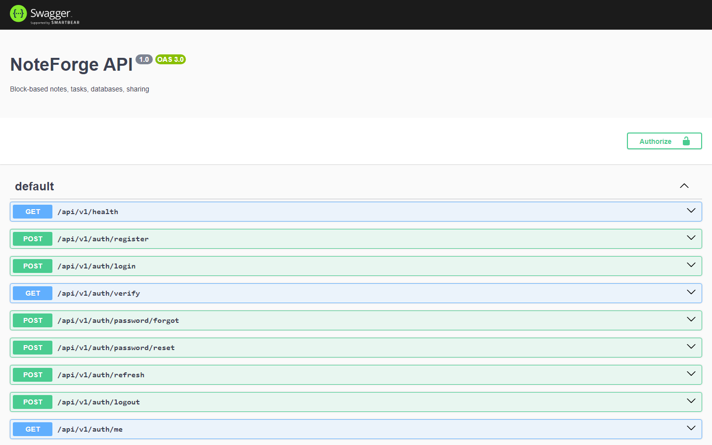
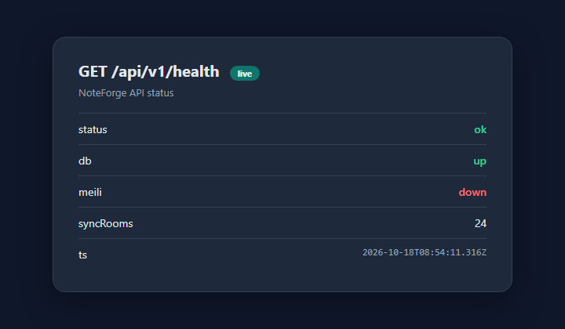

# NoteForge API

[](https://github.com/hamzamaral/NoteForge-api/actions/workflows/ci.yml)


Blok notlar, görevler, veritabanı görünümleri, paylaşım, yorum ve Yjs sync için **REST + Socket.IO** API.

Companion UI: **[NoteForge-web](https://github.com/hamzamaral/NoteForge-web)**

---

## Mimari


| Katman | Rol |
|--------|-----|
| NestJS `:3001` | REST `/api/v1`, Swagger `/api/docs`, Socket `/sync` |
| Postgres `:5434` | Source of truth — `Block`, sayfa, üye, paylaşım |
| Meilisearch `:7700` | Opsiyonel arama indeksi |
| Yjs odaları | Canlı birlikte yazma; kalıcılık REST flush ile |

---

## Ekranlar

### Swagger (OpenAPI)



Authorize → Bearer JWT (login cevabındaki `accessToken`).

### Health



`GET /api/v1/health` → `{ status, db, meili, syncRooms, ts }`

---

## Quick start

```bash
cp .env.example .env
docker compose up -d postgres meilisearch   # Postgres host :5434
npm install
npx prisma migrate deploy
npm run db:seed
npm run start:dev
```

| Servis | URL |
|--------|-----|
| API | http://localhost:3001/api/v1 |
| Swagger | http://localhost:3001/api/docs |
| Health | http://localhost:3001/api/v1/health |

**Demo hesaplar (seed)**

| Rol | E-posta | Şifre |
|-----|---------|-------|
| OWNER | `admin@noteforge.local` | `Admin123!` |
| EDITOR | `editor@noteforge.local` | `Admin123!` |
| VIEWER | `viewer@noteforge.local` | `Admin123!` |

---

## Modules

| Modül | Ne işe yarar |
|-------|----------------|
| **Auth** | register / login / refresh / me, JWT |
| **Workspaces** | üyelik, davet, roller (OWNER / EDITOR / VIEWER) |
| **Pages / Blocks** | SoT blok ağacı, `contentVersion`, şablon & pack |
| **Tasks** | due tarihli görevler |
| **Databases** | table + board props, filter/sort |
| **Shares** | token link, COMMENT / VIEW |
| **Comments** | `blockId` bağlı yorum |
| **Sync** | Socket.IO `/sync` + Y.Doc, `resetRoom` |
| **Search** | başlık / görev / blok `ILIKE` (+ Meili) |

### Search

```http
GET /workspaces/:workspaceId/search?q=meili
```

Cevap: `{ id, title, match, snippet, score }[]` — sıra: title → task → block (ADR 0003).

---

## Docs (mülakat)

- [PRODUCT](docs/PRODUCT.md) · [INTERVIEW](docs/INTERVIEW.md) · [ARCHITECTURE](docs/ARCHITECTURE.md) · [DEMO](docs/DEMO.md) · [ROADMAP](docs/ROADMAP.md) · [BLOCK_SCHEMA](docs/BLOCK_SCHEMA.md)
- ADRs: [TipTap](docs/adr/0001-editor-tiptap.md) · [Tasks before DB](docs/adr/0002-tasks-before-db.md) · [Search ILIKE](docs/adr/0003-search-ilike.md)

---

## Scripts

```bash
npm run start:dev    # watch
npm run build && node dist/main
npm test             # Jest
npx prisma studio    # DB UI
```

Yerel sırlar `.env` içinde kalır — commit etme.
